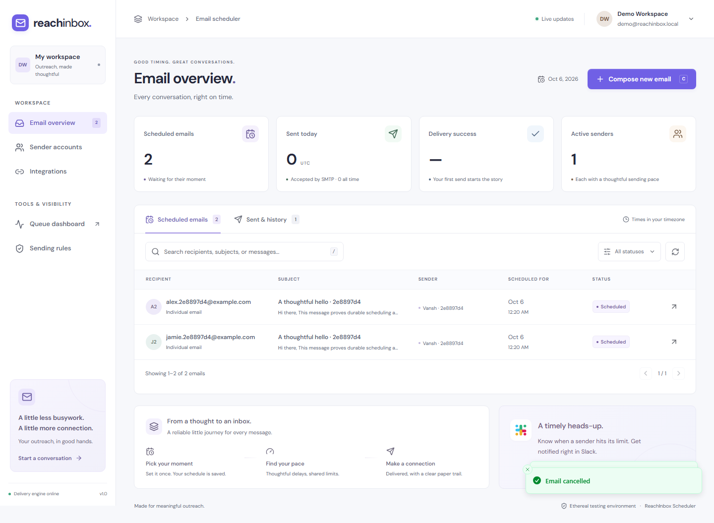
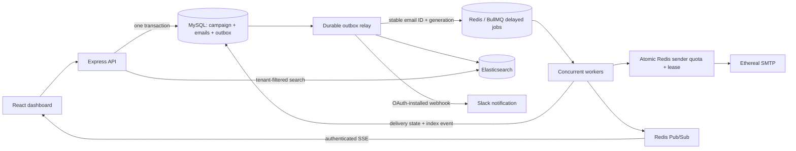

# ReachInbox · Email Scheduler

A full-stack email scheduler with a calm, responsive dashboard and a durable delivery pipeline. Built for the Outbox Labs / ReachInbox engineering assignment using **TypeScript, Express, React, Tailwind CSS, MySQL, BullMQ, Redis, and Elasticsearch**.

Schedule a campaign, restart the server, and keep your place. Sender limits are enforced across processes, SMTP outcomes are recorded explicitly, and every email is searchable.



[Watch the local technical preview](docs/recordings/technical-preview.webm) · [Review validation evidence](docs/VALIDATION.md) · [Assignment coverage](docs/REQUIREMENTS.md)

## Run locally

Requires Node.js 22.12+ (22 LTS recommended), npm, and Docker Desktop with Linux containers.

```sh
npm ci
node scripts/setup-local.mjs
docker compose up -d mysql redis elasticsearch
npm run db:migrate
npm run dev
```

- Dashboard: **http://localhost:5173**
- API / health: **http://localhost:4000/api/health**
- API documentation: **http://localhost:4000/api/docs**
- OpenAPI 3.1 document: **http://localhost:4000/api/openapi.json**
- Live BullMQ dashboard: **http://localhost:5173/admin/queues** (authorized users only)

`npm run dev` starts the API, delivery worker, and frontend as separate processes. `scripts/setup-local.mjs` creates a gitignored `.env` with random session/encryption keys and explicitly labelled **local demo access**. It never overwrites an existing file. Demo access is disabled by default in `.env.example` and rejected in production. It does **not** replace the real Google login implementation.

Create your first real Ethereal SMTP account from **Sender accounts → Add sender → Create test account**. You can add several distinct accounts, or verify and connect an existing Ethereal account. Send a message and use **View in Ethereal** in its details to inspect the actual captured message. Ethereal never delivers to real recipients.

For Windows Command Prompt, enter the cloned directory with `cd /d "<repository-directory>"`, then run the commands above. In PowerShell, use `npm.cmd` if script execution policy blocks `npm`.

## Real Google login and Slack

Follow **[the step-by-step OAuth setup guide](docs/OAUTH-SETUP.md)**. The application implements both actual authorization-code flows; neither integration fabricates a successful connection.

| Integration | Local redirect URI                                      | Environment variables                      |
| ----------- | ------------------------------------------------------- | ------------------------------------------ |
| Google      | `http://localhost:4000/api/auth/google/callback`        | `GOOGLE_CLIENT_ID`, `GOOGLE_CLIENT_SECRET` |
| Slack       | `http://localhost:4000/api/integrations/slack/callback` | `SLACK_CLIENT_ID`, `SLACK_CLIENT_SECRET`   |

Google requests only `openid email profile`, verifies the signed ID token and verified email, and uses state, nonce, and PKCE. Sessions are stored in Redis with an HttpOnly, SameSite cookie; production cookies are Secure. Name, email, and avatar appear in the header. Logout destroys the server-side session.

Slack requests `incoming-webhook`, verifies a single-use session-bound state, exchanges the authorization code, and stores the user's webhook and bot token encrypted with AES-256-GCM. A real HTTPS POST sends the notification when the effective hourly allowance is reached. Notification failures retry in the outbox and do not stop email delivery. No connection means no notification. Disconnect takes effect immediately, and reconnect replaces credentials without a redeploy. Notifications are deduplicated per sender per UTC hour; notification delivery status appears in the dashboard.

Keep `.env` private. No credential or webhook is returned by a read API. Set `QUEUE_ADMIN_EMAILS` to your Google email to enable the read-only Bull Board. Non-admin users cannot inspect other tenants' jobs.

## Architecture



### Scheduling and restart recovery

1. Validate sender ownership, subject/body, addresses, and an ISO timestamp. Deduplicate recipients while preserving order.
2. In **one MySQL transaction**, save the campaign, every email, and enqueue/index outbox events. The API responds only after commit.
3. The relay claims events using short SQL leases and `FOR UPDATE SKIP LOCKED`. It creates BullMQ delayed jobs at `startAt + sequence × effectiveDelay`. Queue IDs are deterministic: `<email UUID>-<generation>`.
4. If the relay crashes after enqueueing but before acknowledging, replaying the event reuses the same queue ID. If it crashes before enqueueing, its lease expires and another relay retries. The relay's bounded polling is transport/reconciliation work; **email timing always uses BullMQ delayed jobs, never cron**.
5. Redis uses a persistent named volume, AOF, `appendfsync always`, and `noeviction`. MySQL and Elasticsearch have separate persistent volumes. Completed queue records are retained for seven days; SQL delivery state remains the final duplicate guard after queue cleanup.
6. On worker startup, nonterminal scheduled/deferred rows are reconciled into the queue, and stale in-flight records are flagged for review. An email already marked `sent` cannot be sent by a replayed job. The API can restart independently; workers continue delivering. Redis-backed sessions survive an API restart.

Delivery is **at or after** the requested time. Provider throttling, outages, or workers being offline can delay it. Outbox crash recovery has a bounded 60-second lease delay. Durable volumes are required; `docker compose down` preserves them, while removing volumes destroys state.

### Concurrency, delay, and hourly limits

| Setting                          | Default | Meaning                                                               |
| -------------------------------- | ------- | --------------------------------------------------------------------- |
| `WORKER_CONCURRENCY`             | `8`     | Active jobs per worker process; additional processes share limits     |
| `MIN_SEND_DELAY_MS`              | `2000`  | Minimum gap after the previous SMTP attempt finishes, per sender      |
| `MAX_EMAILS_PER_HOUR_PER_SENDER` | `200`   | Hard server cap for a sender's send attempts in a fixed UTC hour      |
| `SMTP_TIMEOUT_MS`                | `25000` | Absolute deadline for an SMTP attempt, plus socket/connect timeouts   |
| `SEND_LEASE_MS`                  | `60000` | Distributed sender lease; must exceed the SMTP deadline by 10 seconds |
| `MAX_SEND_ATTEMPTS`              | `4`     | Maximum automatic attempts after definite transient failures          |
| `OUTBOX_POLL_MS`                 | `500`   | Idle relay polling interval; not an email scheduler                   |

An atomic Redis Lua script uses **Redis server time** to check the sender's hour, allocated count, cooldown, and distributed send lease. Only a permitted reservation increments the count. A lease allows at most one SMTP attempt per sender at a time; different senders can run concurrently. Lease release sets the next permissible time after the SMTP attempt ends, so parallel workers cannot compress the configured gap.

The effective hourly cap is the minimum of server cap, sender cap, and campaign choice. All campaigns for one sender share the counter. A lower-cap campaign waits when that shared usage reaches its cap; another campaign with a higher cap can still use the sender's remaining hard allowance. A slot counts an **attempted dispatch**, including rejected/retried attempts. This conservative choice prevents retries from exceeding a provider allowance. Cancelled jobs racing with a reservation may consume a slot but will not send.

When exhausted, the worker moves the job to the next UTC hour using `moveToDelayed` and BullMQ's `DelayedError`. Small sequence-based offsets spread resumed jobs. Throttling does not drop jobs or consume a failure retry. Fixed UTC windows permit a burst on either side of a boundary; this is a documented fixed-window limit, not a rolling-hour claim.

For 1,000+ simultaneous emails, jobs stay in persistent Redis and recipients in indexed MySQL tables. Worker concurrency bounds active work; the per-sender lease and quota serialize delivery safely. Existing due-time/sequence ordering is preserved where practical, but contention, retries, and multiple workers can reorder close-together emails. Strict FIFO across campaigns is not promised.

### Idempotency and the SMTP crash window

- `Idempotency-Key` is required for campaign creation. A unique `(user_id, key)` plus the payload hash makes concurrent identical requests return one campaign. Reusing the key for a changed request returns **409**.
- Workers claim delivery through an atomic guarded SQL transition. Every message has a stable `Message-ID`. Completed, cancelled, failed, and uncertain messages are skipped on queue replay.
- **SMTP does not offer an exactly-once transaction spanning Redis, SQL, and the receiving server.** A disconnect after acceptance, or a crash between SMTP acceptance and committing `sent`, can leave delivery ambiguous. The service records `delivery_unknown` and prevents an automatic resend. A human can inspect Ethereal. This avoids silently claiming exactly-once SMTP delivery.
- Definite temporary failures (e.g. connection refusal or an explicit 4xx response) use bounded exponential retries. Credentials and permanent SMTP rejection become `failed`. Only a confirmed failure can be manually retried, with a new queue generation. Unknown outcomes cannot be retried from the dashboard.

### Search and isolation

Every email insert and state transition adds an index event in the same transaction. Index writes use the email revision with Elasticsearch `external_gte` versioning to prevent an older event overwriting a newer state. Search covers recipients, subject, and body, and always filters `userId` and selected statuses. Returned IDs are checked against tenant-scoped SQL before returning current data.

Search is eventually consistent (relay + Elasticsearch refresh). If Elasticsearch is unavailable, scheduling/sending continue and index events retry; search returns an explicit **503**, while clearing the search restores ordinary SQL browsing. It never substitutes a fake/in-memory search result.

## Frontend

See the [complete assignment coverage map](docs/REQUIREMENTS.md) for implementation and verification evidence for every requirement.

- Real Google sign-in, profile header, and logout.
- Scheduled and sent/history tables, paginated and searchable through Elasticsearch.
- Plain-text compose with sender choice, CSV/TXT upload, paste, detected lead counts, duplicate removal, and invalid-address feedback.
- Start time in the browser's timezone, configurable delay and hourly cap, live message preview.
- Sender creation/verification and current Redis-backed sender usage.
- Status details, cancellation, safe retry for confirmed failures, and real Ethereal preview links.
- Slack connect/reconnect/disconnect, notification history, service health, and authorized Bull Board access.
- Loading skeletons, empty states, recoverable errors, toast feedback, keyboard shortcuts (`C`, `/`), focus-trapped dialogs, and mobile layouts.
- Event-driven refresh through tenant-scoped SSE, with polling fallback.

The supplied brief contained the words “Figma Link” but no URL or design assets. The dashboard therefore uses an original, consistent ReachInbox-inspired visual design rather than claiming an unavailable Figma match.

## API and examples

Interactive documentation is served at `/api/docs` and the OpenAPI document at `/api/openapi.json`. Authentication uses the session cookie. Obtain your CSRF token from `/api/auth/me`; writes need `X-CSRF-Token`. Use the browser network panel or an API client with the session cookie jar.

```http
POST /api/campaigns
Content-Type: application/json
Idempotency-Key: a-new-uuid-for-this-request
X-CSRF-Token: <token-from-auth-me>
Cookie: reachinbox.sid=<your-session-cookie>

{
  "senderId": "<sender-uuid>",
  "subject": "Let’s start a conversation",
  "body": "Hi Alex,\n\nI’d love to connect.\n\nBest,\nVansh",
  "recipients": ["alex@example.com", "sam@example.com"],
  "startAt": "2026-10-06T01:00:00+05:30",
  "delaySeconds": 2,
  "hourlyLimit": 200
}
```

Choose an actual future timestamp when trying the example. Sample upload files are in [`examples/`](examples/).

| Endpoint                              | Behavior                                 |
| ------------------------------------- | ---------------------------------------- | ------------------------- |
| `GET /api/emails?view=scheduled       | sent&q=...&page=1&pageSize=15`           | Tenant-scoped list/search |
| `POST /api/campaigns`                 | Atomic schedule with request idempotency |
| `GET /api/emails/:id`                 | Current status, body and preview         |
| `DELETE /api/emails/:id`              | Cancel only scheduled/deferred delivery  |
| `POST /api/emails/:id/retry`          | Retry a confirmed failure only           |
| `GET /api/senders`                    | Sender identities, caps and live usage   |
| `POST /api/senders/ethereal`          | Create a distinct test account           |
| `POST /api/senders`                   | Verify/connect an existing account       |
| `GET /api/overview`                   | Scoped metrics and worker presence       |
| `GET /api/events`                     | Authenticated change stream              |
| `GET /api/integrations/slack/connect` | Actual Slack authorization               |
| `DELETE /api/integrations/slack`      | Disconnect and revoke                    |
| `GET /api/notifications`              | Notification delivery history            |

## Tests and evidence

```sh
npm run check                 # strict TypeScript, unit contracts, production build
npm run test:integration      # isolated DB + Redis DB 2, real Ethereal SMTP, real Elasticsearch
npm run test:e2e              # actual browser workflows and accessibility checks
```

Integration tests require a dedicated `reachinbox_test` database. On the project's local containers:

```sh
docker compose exec mysql mysql -uroot -preachinbox_root_dev -e "CREATE DATABASE IF NOT EXISTS reachinbox_test; GRANT ALL ON reachinbox_test.* TO 'reachinbox'@'%';"
docker compose exec mysql mysql -uroot -preachinbox_root_dev -e "CREATE DATABASE IF NOT EXISTS reachinbox_e2e; GRANT ALL ON reachinbox_e2e.* TO 'reachinbox'@'%';"
```

The root password above is the Compose **local development default**, not a production credential. Set `TEST_DATABASE_URL` / `TEST_REDIS_URL` if your test services differ. The suite refuses to use the application database, starts isolated API and worker child processes, and never resets your development data. It exercises concurrent idempotency, abrupt API/worker restart, real SMTP acceptance and previews, shared quotas across two workers, over-limit deferral, tenant isolation, search, a 1,001-recipient batch, and guarded cancellation/retry.

The browser suite uses `reachinbox_e2e`, Redis DB 3 and port 4201, resetting only that isolated test data. Install its Chromium binary with `npx playwright install chromium --with-deps` when needed. It records a local technical preview and commits no credentials. Google and Slack secrets in your normal `.env` are intentionally disabled for this isolated demo-access scenario.

OAuth redirect/state checks are automated; full Google account consent and live Slack installation must be verified with account-owned credentials. Slack transport in the isolated integration suite uses a clearly identified local HTTP fixture, **not a fake claim of live Slack delivery**. See [validation notes](docs/VALIDATION.md) and [demo guide](docs/DEMO.md).

## Docker and deployment

The multi-stage image compiles both apps, serves the built frontend from Express, prunes development dependencies, and runs as the non-root `node` user. Local infrastructure ports bind to loopback.

To run all components in Docker, set `APP_URL=http://localhost:4000` and `API_URL=http://localhost:4000` in the local `.env`, stop any host API using port 4000, then:

```sh
docker compose --profile full up --build -d
```

For a public deployment, use a Docker-capable host with persistent SQL/Redis storage and an HTTPS reverse proxy. Set `NODE_ENV=production`, `DEMO_MODE=false`, strong secrets, the actual `APP_URL`/`API_URL`, Google OAuth credentials, and the authorized production callback URLs. Keep Redis/MySQL/Elasticsearch private; development Elasticsearch explicitly disables security only on the loopback-bound Compose network. Use authenticated/TLS-managed services on an external network. `DATABASE_URL` supports `?ssl=true`; Redis supports `rediss://`.

Scale worker processes independently. For shutdown, send SIGTERM so the worker drains active jobs and closes the relay. Back up MySQL and preserve Redis AOF. Do not expose the demo login publicly or commit `.env`. See [deployment checklist](docs/DEPLOYMENT.md).

## Repository layout

```text
apps/api/src/       auth, routes, scheduler, delivery, Lua quota, search, outbox
apps/api/sql/       versioned MySQL migrations
apps/web/src/       React dashboard, reusable dialogs/UI, typed API, lead parser
tests/             unit contracts, isolated integration suite, browser workflows
docs/              architecture/setup, validation, screenshots, demo guide
examples/          sample CSV/TXT lead imports
compose.yaml       persistent local MySQL, Redis, Elasticsearch, optional full stack
Dockerfile         portable non-root application image
```

Each Google identity owns one workspace/tenant in this assignment. Team membership, billing, actual email delivery, and production cloud provisioning are outside its scope. Ethereal accounts are testing infrastructure; create fresh accounts for a later demo if old test accounts expire.
